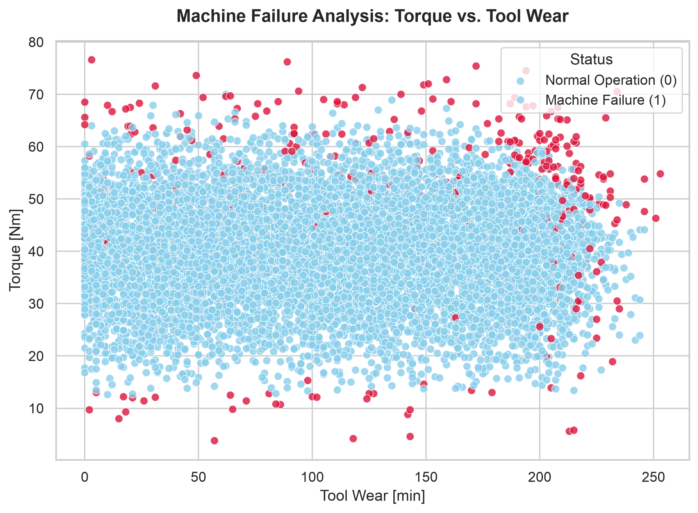

# Predictive Maintenance & Component Failure Classifier

## 📌 Project Overview
An end-to-end machine learning project analyzing industrial milling machine telemetry data to predict equipment failures before they happen. Designed to minimize unexpected mechanical downtime and optimize asset management.

## 📊 Dataset
* **Source:** AI4I 2020 Predictive Maintenance Dataset (Kaggle)
* **Size:** 10,000 data points across 14 features
* **Target Variable:** Binary `Machine failure` (imbalanced class, ~3.4% failure rate)

## 🔍 Exploratory Data Analysis & Visualization
To understand the physical triggers of failure, I plotted mechanical stress (**Torque**) against component degradation (**Tool Wear**):

* **Key Insight:** Failures cluster heavily at extreme operational thresholds where high tool wear compounds with abnormal torque spikes.

## 🤖 Machine Learning Model
* **Algorithm:** Random Forest Classifier (with `class_weight='balanced'` to handle class imbalance)
* **Performance Metrics:**
  * **ROC-AUC Score:** 0.9633
  * **F1-Score (Failure Class):** 0.69
* **Top Predictive Features:**
  1. Torque [Nm] (~33.4%)
  2. Rotational speed [rpm] (~30.1%)
  3. Tool wear [min] (~22.0%)

## 🛠️ Tech Stack
* **Language:** Python
* **Libraries:** Pandas, Scikit-Learn, Seaborn, Matplotlib
